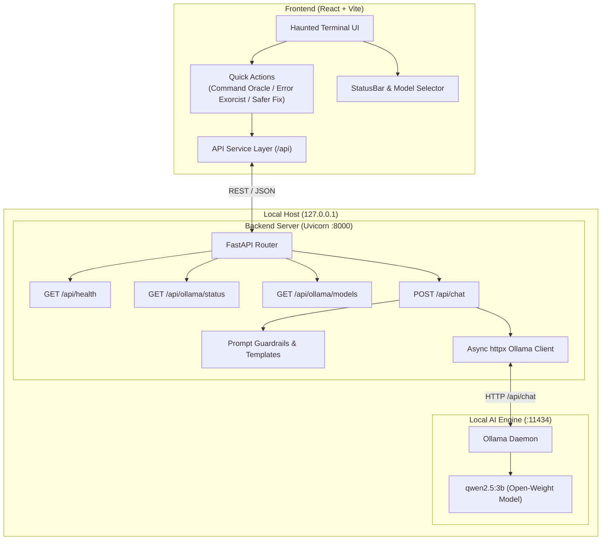

# GhostShell — Haunted AI Terminal

> *"Your terminal has a ghost. It knows your code."*

[](https://hacktoberfest.com/)
[]()
[](https://fastapi.tiangolo.com)
[](https://vitejs.dev)
[-black?style=flat-square)](https://ollama.com)
[](LICENSE)

---

## 👻 Project Overview

**GhostShell** is an open-source, atmospheric terminal-inspired developer companion built for **Hacktoberfest 2026 (Week 4: "Ghost in the Machine")**. 

It embeds an AI "phantom" directly into your command-line workflow that analyzes arcane shell flags, exorcises cryptic build errors and stack traces, and recommends safer alternatives—**all executed 100% locally on your machine using open-weight models via Ollama**.

GhostShell never connects to paid cloud AI APIs, never uploads your terminal logs or codebase to external servers, and strictly refrains from autonomously executing arbitrary shell commands on your host system.

---

## 🎯 Problem & Target Audience

Modern command-line environments are fraught with subtle footguns:
1. **Destructive Shell Flags:** A misplaced `-rf`, recursive chmod, or unquoted glob can cause irreversible data loss.
2. **Cryptic Stack Traces & Compiler Errors:** Error dumps from Docker, Kubernetes, Git, Rust/C++, or Node.js can be hundreds of lines long and obscure the true root cause.
3. **Data Privacy Fears:** Engineers working in regulated industries, on proprietary enterprise code, or on air-gapped systems cannot upload sensitive command outputs or logs to hosted cloud AI endpoints.

**Target Audience:**
- Software Engineers & DevOps Practitioners debugging complex CLI workflows
- System Administrators looking for safe sanity checks before running system-level mutations
- Developers who value local, private, and open-weight AI tooling

---

## 🌟 Key Features

### ✅ Implemented in this MVP
- **Haunted Cyberpunk / Terminal UI:**
  - Deep charcoal and near-black aesthetic (`#07090e`).
  - Neon mint / spectral green accents (`#00ff9d`) with subtle cyan highlights and restrained purple glows.
  - Monospace typography (`Fira Code`, `JetBrains Mono`) with custom SVG Ghost avatar.
  - Fully responsive layout for desktop, tablets, and mobile devices.
  - High accessibility: respects `prefers-reduced-motion` and clear color contrasts.
- **Three Quick Action Specializations:**
  - 🔮 **Command Oracle:** Dissects complex commands, explaining flags, expected behavior, side-effects, destructive risks, and safer alternatives.
  - 🛡️ **Error Exorcist:** Ingests pasted terminal stack traces and logs, returning structured explanations, most probable cause, step-by-step diagnostic actions, and fix precautions.
  - ✨ **Safer Fix:** Evaluates dangerous commands and recommends non-destructive, dry-run, or staged alternatives.
- **Real Local AI Integration (Ollama):**
  - Asynchronous, non-blocking HTTP integration via `httpx`.
  - Default model: `qwen2.5:3b` (configurable via `OLLAMA_MODEL`).
  - Automatic detection of running Ollama daemon, version, and local model library.
  - Dynamic model dropdown selector in the UI.
  - Clear, user-friendly offline and disconnected states with precise recovery commands.
- **Defensive Security & Privacy:**
  - Zero autonomous command execution (commands are strictly analyzed, never executed).
  - All input treated as untrusted text with prompt injection mitigation.
  - Localhost binding (`127.0.0.1`) and restricted CORS configuration.
  - Complete prompt privacy: zero telemetry, zero analytics, zero external network requests.
- **Interactive Developer Ergonomics:**
  - Multi-line command input with Enter-to-send and Shift+Enter for newlines.
  - Per-code-block copy button and full-message copy button.
  - Conversation clear button and live token count badges.

### 🔮 Planned for Future Milestones
- Native streaming response output (SSE / token-by-token streaming).
- SQLite-backed local session history and bookmarking.
- Shell history importer (`.bash_history`, `.zsh_history`, PowerShell history) for retroactive audit.
- Local custom GGUF model loader.

---

## 📸 Screenshots

*(Placeholders — screenshots will be added upon final release tagging)*

| Terminal View & Status Bar | Error Exorcist Diagnosis |
| :---: | :---: |
|  |  |

---

## 🏛️ Architecture



---

## 🛠️ Tech Stack

- **Frontend:**
  - React 18
  - Vite 5
  - Plain CSS with CSS Variables
  - Lucide React icons
- **Backend:**
  - Python 3.10+
  - FastAPI
  - Uvicorn
  - Pydantic v2
  - HTTPX (Async HTTP Client)
  - pytest & pytest-asyncio
- **AI Engine:**
  - Ollama local inference API
  - Suggested Model: `qwen2.5:3b`

---

## 📋 Prerequisites

Before running GhostShell, ensure you have installed:
1. **Node.js** (v18.0.0 or later) & `npm`
2. **Python** (v3.10 or later)
3. **Ollama** ([Download from ollama.com](https://ollama.com))

---

## 🚀 Installation & Setup (Windows PowerShell)

Follow these step-by-step instructions in Windows PowerShell.

### Step 1: Clone or Navigate to the GhostShell Folder

```powershell
cd C:\Users\ADMIN\OneDrive\Desktop\ghostshell
```

### Step 2: Install and Start Ollama

1. If you haven't installed Ollama, download and run the installer from [ollama.com/download](https://ollama.com/download).
2. Start the Ollama background daemon:
   ```powershell
   ollama serve
   ```
3. In another PowerShell window, pull the recommended open-weight model:
   ```powershell
   ollama pull qwen2.5:3b
   ```

*(You can also use other models such as `llama3.2:3b`, `mistral`, or `codellama`)*.

---

### Step 3: Backend Setup

In your GhostShell project directory:

```powershell
# 1. Create a Python virtual environment
python -m venv .venv

# 2. Activate the virtual environment
.\.venv\Scripts\Activate.ps1

# 3. Install backend dependencies
pip install -r backend/requirements.txt

# 4. (Optional) Copy environment configuration
Copy-Item .env.example .env

# 5. Start the FastAPI backend server
python -m uvicorn app.main:app --app-dir backend --host 127.0.0.1 --port 8000 --reload
```

The backend will be available at:
- **API URL:** `http://127.0.0.1:8000`
- **Swagger Documentation:** `http://127.0.0.1:8000/api/docs`
- **Health Check:** `http://127.0.0.1:8000/api/health`

---

### Step 4: Frontend Setup

Open a separate PowerShell terminal:

```powershell
# 1. Navigate to frontend directory
cd frontend

# 2. Install dependencies
npm install

# 3. Start Vite development server
npm run dev
```

Open your browser at **`http://localhost:5173`**.

---

## 📡 API Endpoints

| Method | Endpoint | Description |
| :--- | :--- | :--- |
| `GET` | `/api/health` | Backend health check and application metadata |
| `GET` | `/api/ollama/status` | Connectivity check to local Ollama daemon & version |
| `GET` | `/api/ollama/models` | List locally downloaded models in Ollama |
| `POST` | `/api/chat` | Send terminal prompts, commands, or errors to local AI |

### Example Chat Request:
```json
POST /api/chat
Content-Type: application/json

{
  "message": "explain: tar -xzvf archive.tar.gz -C /opt/app",
  "mode": "command_oracle",
  "model": "qwen2.5:3b"
}
```

---

## 🧪 Testing

The backend includes a comprehensive pytest suite covering status checks, model discovery, input validation, and Ollama failure handling:

```powershell
# Run backend test suite
.\.venv\Scripts\pytest -v tests/
```

To run the frontend production build:

```powershell
cd frontend
npm run build
```

---

## 🔐 Privacy & Security Design

- **No Remote Telemetry:** GhostShell does not send user input, command history, or error logs to any external third-party server or cloud AI provider.
- **No Command Execution:** GhostShell operates strictly as an advisory analysis tool. It **never** invokes `subprocess`, `os.system`, `exec`, or `eval` to run user or model commands.
- **Untrusted Input Treatment:** All logs, commands, and code snippets are passed as untrusted user payloads with explicit system instructions to prevent prompt injection.
- **Localhost Bound:** Default servers bind strictly to `127.0.0.1`.

---

## 💡 Why Open-Weight & Local AI Innovation Matters

For developer tooling, privacy and agency are non-negotiable. Pasting proprietary stack traces, authentication errors, internal file paths, or private repo configurations into hosted multi-tenant cloud AI models introduces significant security and compliance exposure.

By building on open-weight foundation models like **Qwen 2.5** and running them through open local runtimes like **Ollama**, developers regain:
1. **Complete Data Sovereignty:** Your code and secrets never leave your device.
2. **Deterministic Availability:** Work seamlessly on airplanes, trains, or air-gapped corporate intranets without relying on external internet connectivity.
3. **Zero API Metering:** Experiment freely without token limits, API keys, subscription tiers, or credit card billing.

---

## 🤝 Contributing

Contributions are welcome! Please follow these steps:
1. Fork the repository.
2. Create a feature branch (`git checkout -b feature/spectral-enhancement`).
3. Commit your changes (`git commit -m 'feat: add enhanced diagnostic parser'`).
4. Push to the branch (`git push origin feature/spectral-enhancement`).
5. Open a Pull Request.

---

## 📄 License

This project is licensed under the [MIT License](LICENSE).
